# Error Budget Guard

[](https://github.com/sonujha78/error-budget-guard/actions/workflows/ci.yml)

A small Go tool that answers three questions with numbers, not feelings:

1. **How reliable were we?** (the SLI over the SLO window)
2. **How much unreliability can we still afford?** (the error budget: total, used, remaining)
3. **Should we deploy right now?** (a release gate that says `allow`, `warn` or `block`, with reasons a person can check)

It reads request data from more than one kind of source, turns it into one clean stream of good/valid events, computes SLI, budget and burn rate, raises multi-window multi-burn-rate alerts, forecasts when the budget runs out, writes a Markdown report, and works as a CI release gate with exit codes.

It is built so that it says **"insufficient data"** instead of giving a false alert or false comfort, and so that **the same recorded data always gives the same report**.

Everything runs locally and in GitHub Actions. No paid cloud service, no agent installed on the services.

> This is portfolio project 4 of a DevOps/SRE interview series. The task statement was "Project 4: Error Budget Guard". The ideas come from the Google SRE books and from tools like Sloth, Pyrra and OpenSLO. This is a learning project, not a replacement for them.

---

## Table of contents

1. [Results at a glance](#results-at-a-glance)
2. [Quick start](#quick-start)
3. [Architecture](#architecture)
4. [Key design decisions (and why)](#key-design-decisions-and-why)
5. [Build log, step by step](#build-log-step-by-step)
6. [Problems found and how they were fixed](#problems-found-and-how-they-were-fixed)
7. [Coverage of the task requirements](#coverage-of-the-task-requirements)
8. [Known limitations (honest)](#known-limitations-honest)
9. [CLI and exit codes](#cli-and-exit-codes)
10. [Repository layout](#repository-layout)
11. [Interview talking points](#interview-talking-points)
12. [Tech used](#tech-used)

---

## Results at a glance

Five scenarios were recorded with Docker Compose (nginx, a small Go service with `/metrics`, and a deterministic load generator). The **expected outcome of each scenario was written down before it was recorded**, in the scenario file's `description`. After recording, `ebg verify` compares reality with the expectation, and CI runs it on every pull request.

| Scenario | What was injected (ground truth) | Gate | Alerts | Other checks |
|---|---|---|---|---|
| `healthy` | 1800 requests, 3 errors (every 500th) | **ALLOW** (exit 0) | none, zero episodes | no flapping |
| `slow-burn` | 1800 requests, 12 errors (every 25th, last 30 s) | **WARN** (exit 1) | only the slow-burn ticket, starts 20 s after onset | forecast 15.00 s, true value 15 s, **error 0.0%** |
| `fast-burn` | 1800 requests, 100 errors, all on `/api/pay`, 100 s to 120 s | **BLOCK** (exit 2) | page alerts start **1.5 s** (fast) and **2.0 s** (medium) after onset | report names `/api/pay` (100%) |
| `latency-degradation` | 1800 requests, 12 slow ones (800 ms) on `/api/search`, last 30 s | **WARN** (exit 1) | only the latency SLO's slow-burn ticket (21 s after onset), availability stays clean | forecast 14.47 s, true 15 s, **error 3.5%** |
| `low-traffic` | 90 requests (0.5 per second), 10 of them fail during a 20 s outage | **WARN** (exit 1) | nothing fires, all 3 rules say "insufficient data" | SLO table shows `n/a`, no invented numbers |

How the data was cross-checked:

- For every scenario, the **nginx access log** and the **Prometheus scrapes** of the app give the **same (good, valid) counts**. For example, `fast-burn`: availability (1700, 1800) from both sources.
- The raw logs contain **fake secrets on purpose** (token, user id, cookie, client IP). They never appear in `ebg parse` output, in stats files, in reports, or in gate output.
- Running the report generator twice gives byte-identical reports for all five scenarios.
- The CI was **deliberately broken once** (see [step 11](#step-11-ebg-verify-github-actions-and-a-deliberate-ci-failure)) and it failed and blocked the merge, as it should.

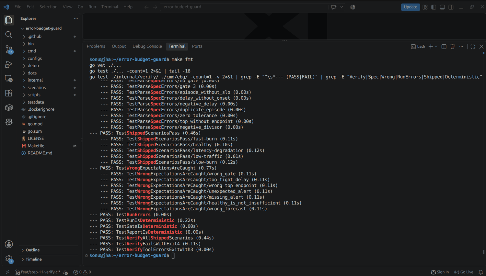

---

## Quick start

Needs Go 1.22+. Docker and Docker Compose are needed only to record new scenarios.

```bash
git clone https://github.com/sonujha78/error-budget-guard.git
cd error-budget-guard

make build            # builds bin/ebg
make test             # all unit and integration tests
make verify           # runs ebg verify on the five recorded scenarios (exit 0 = all as expected)
make reports          # regenerates scenarios/*/report.md from the recorded data
```

Look at one scenario by hand:

```bash
# 1. nginx JSON log -> common events
./bin/ebg parse --slo configs/demo/slos.yaml --format json \
    --interval 1s --stats-out /tmp/q.json scenarios/fast-burn/access.log > /tmp/events.jsonl

# 2. which alerts fired and when (replayed over time)
./bin/ebg alerts --slo configs/demo/slos.yaml --alerts configs/demo/alerts.yaml \
    --events /tmp/events.jsonl --step 500ms

# 3. release gate: exit 0 allow, 1 warn, 2 block
./bin/ebg gate --slo configs/demo/slos.yaml --alerts configs/demo/alerts.yaml \
    --policy configs/policy.yaml --events /tmp/events.jsonl --forecast-divisor 12
echo "exit code: $?"

# 4. Markdown report (add --quality /tmp/q.json to show how much data was missing or malformed)
./bin/ebg report --slo configs/demo/slos.yaml --alerts configs/demo/alerts.yaml \
    --policy configs/policy.yaml --events /tmp/events.jsonl --quality /tmp/q.json
```

Emergency override (the reason is required, is scrubbed of secrets, and always appears in the output and the report):

```bash
./bin/ebg gate ... --override "hotfix for sev1 outage" --override-by alice
# decision: BLOCK, OVERRIDDEN by alice: "hotfix for sev1 outage" -> ALLOW (exit 0)
```

Record a scenario again (about 3.5 minutes each; uses ports 19080 and 19081 on 127.0.0.1 and containers named `ebg-*`):

```bash
./scripts/record-scenario.sh fast-burn
python3 scripts/check-truth.py scenarios/fast-burn
```

Recording is real traffic, so timing differs a little between machines. That is why CI **verifies** the committed recordings instead of re-recording them.

---

## Architecture

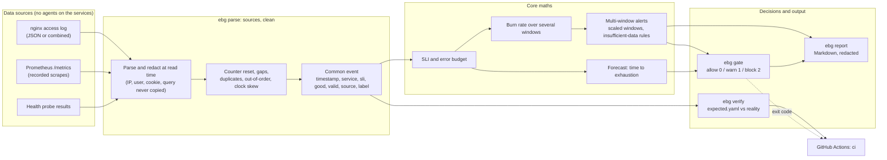

Demo environment (Docker Compose, everything named `ebg-*`, ports bound to 127.0.0.1 only):

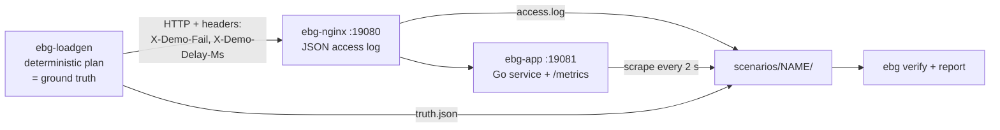

The fault injection is on the client side: the load generator tells the app, per request, to fail or to be slow. So the ground truth is the load generator's own plan, and the plan is deterministic (every Nth request, no random numbers). The expected outcome can be worked out by hand before anything is recorded.

---

## Key design decisions (and why)

**Language: Go.** One static binary is easy to run in CI and in a demo, and exit codes (0/1/2) go straight into shell and GitHub Actions. The whole ecosystem (Prometheus, Sloth, Pyrra, OpenSLO tooling) is Go. Determinism is easy: no `time.Now()` in the logic, and maps are sorted before they are printed. The only third-party dependency is `gopkg.in/yaml.v3`; the Prometheus text format is parsed by hand and tested.

**What is a good and a valid event?** Defined per SLO in YAML.
- *Availability:* valid = every request except the excluded status classes (4xx are client mistakes). Good = valid and the status class is in the allowed list (2xx, 3xx).
- *Latency:* good = allowed status class **and** latency <= threshold. A 5xx is valid but **never good**, even when it was fast. (This is why, in the `fast-burn` scenario, both the availability and the latency SLO fire.)

**One common event format** so a new source is easy to add:

```json
{"timestamp":"2026-11-25T11:37:11.255Z","service":"demo","sli":"availability","good":0,"valid":1,"source":"nginx-log","label":"/api/pay|5xx"}
```

The task asked for timestamp, service, good, valid, source and a short label. One field was added: **`sli`**, because the same service has an availability and a latency count and they must not be mixed. The label is `endpoint|status_class`. A new source only has to produce events; nothing else changes.

**Budget maths** (request based):

```
SLI              = good / valid
budget ratio     = 1 - objective                 (0.001 for 99.9%)
budget total     = valid x budget ratio          (in events)
budget used      = valid - good
burn rate        = (bad / valid) / budget ratio
budget consumed  = burn x duration / SLO window
```

Worked example from the task, which is a unit test: a 99.9% SLO over 30 days burning at 14.4x for 1 hour uses `14.4 x 1h / 720h = 2%` of the budget. The same test file also checks 6x for 6 h = 5% and 1x for 3 days = 10%. Overspent budget is clamped to 0 remaining and flagged `overspent`, so it never goes negative, but the used fraction (for example 555.6%) still tells the truth.

**Why several windows and burn rates, not one threshold.** A rule fires only when **both** its long and its short window burn at or above the threshold. The long window shows that real budget is going. The short window shows that it is still going now, so an alert stops soon after the problem stops, and a short blip alone cannot page. Different burn rates catch fast outages (14.4x, page) and slow leaks (1x, ticket).

**How windows scale for a demo without breaking the maths.** All windows of a rule are multiplied by `SLO window / reference window`, and the burn thresholds do not change. So "14.4x for 1 h = 2% of the budget" stays true at any scale. This is a test. The default policy `configs/alerts.yaml` is the Google-style 30-day policy (14.4x over 1h/5m page, 6x over 6h/30m page, 1x over 3d/6h ticket). The demo uses its own policy, `configs/demo/alerts.yaml`, written in seconds for a 3 minute SLO window, because the 2%/5%/10% proportions would need windows of 1.5 to 18 seconds, which is too short to hold enough requests. The demo policy and the reason are documented in the file.

**How uncertainty is shown.** Every rule and the budget can be in one of three states: OK, FIRING, or **insufficient data** with a reason. Insufficient means: no data, history covers less than 80% of the rule's own long window, or too little traffic in the long window (enough that 5 events would be bad at the threshold burn), or the whole budget is smaller than one event. Insufficient rules never fire, and budget numbers are shown as `n/a`, not as 100%.

**Release gate.** A written policy (`configs/policy.yaml`) with strict parsing. A missing required field is a tool error, never a silent "allow". Order: a firing page alert blocks; budget below 10% blocks; a ticket alert, budget below 25%, or a forecast that runs out within 25% of the window warns; insufficient data follows `on_insufficient` (`warn` or `block`, never `allow`). Every decision lists its reasons with the numbers. An override needs a reason (at least 10 characters) and a name, makes the exit code 0, and **always stays visible** in the output and the report together with the original decision and reasons.

**Exit codes.** 0 allow, 1 warn, 2 block, **3 tool error**, 4 verify failed. A broken run can never look like "allow". Even `-h` on `gate` exits with 3.

**Privacy.** Two layers. First, parsers copy only time, service, endpoint, status and latency, so IPs, user ids, cookies, referers and user agents never enter any struct. Paths lose query strings and path parameters, and numeric/UUID/long-hex path segments become `:id`. Parse errors contain only a line number and a fixed reason, never the line. Second, a `redact` package scrubs free text (override reason, titles, warnings) and the final report. It is idempotent and does not change normal report text (both tested).

---

## Build log, step by step

Working rules used in every step (lessons from earlier projects in the series):

- One small branch and one pull request per step, squash merged. `main` is protected by a ruleset (no direct push, no force push, no delete, PR required; from step 11 also the `ci` check).
- **Tests first.** The new logic gets failing tests first ("red"), then the code ("green"). Where the test would not compile yet, a real failing assertion was shown separately when possible.
- **Real data, not only synthetic tests.** Most steps ended with a check on real traffic (a real nginx container, a real Prometheus container) and the real bugs were found there.
- Commands that check something print `PASS` or `FAIL`; the commit was gated on `PASS`.
- Honest numbers: where a threshold was chosen by design and not tuned, it says so.

### Step 0: Repository, ruleset, skeleton

**What:** repo created (public, MIT), a `protect-main` ruleset, Go module, folder layout, `Makefile`, minimal `ebg` entry point.
**Why:** so that every later change goes through a PR and CI.
**Proof:** a dummy direct push to `main` was rejected with `GH013: Repository rule violations found ... Changes must be made through a pull request`.

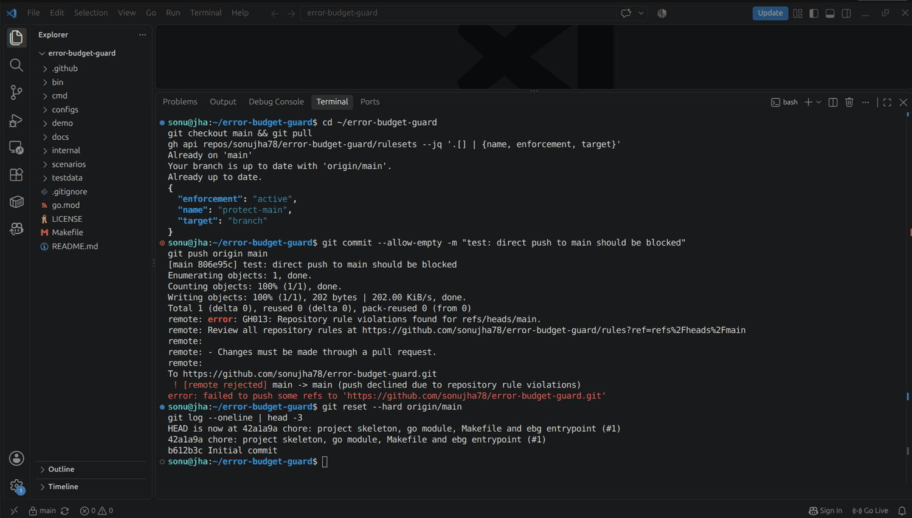

### Step 1: Common event format and SLO YAML loader

**What:** `internal/event` (the event, validation, a total sort order so the same input always gives the same output) and `internal/slo` (strict YAML loader, `30d` style durations, good/valid rules).
**Why:** one clean event stream is the base of everything. Strict YAML (unknown fields are errors) so a typo is never silently ignored.
**Result:** red run failed with `undefined: Event`; green run passed for both packages.

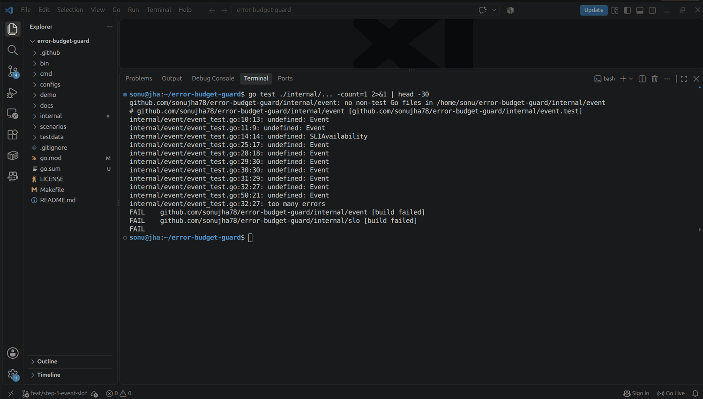
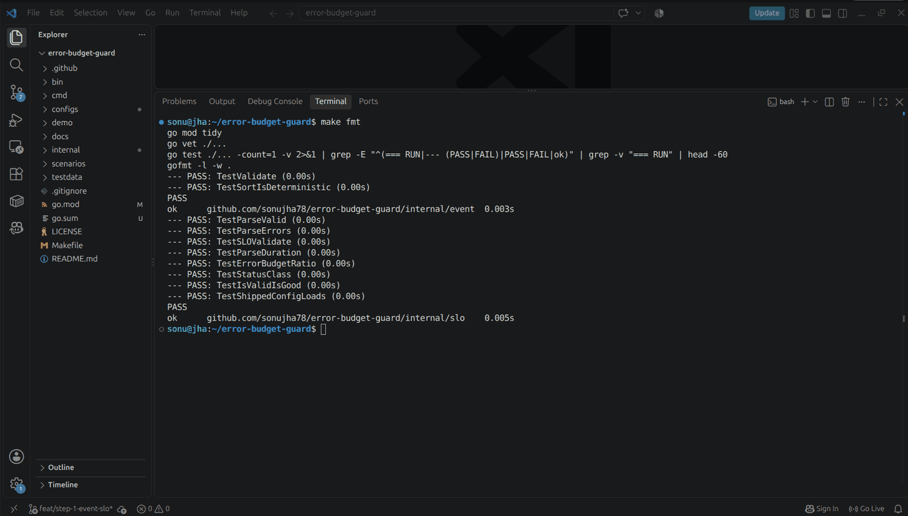

### Step 2: SLI, error budget and burn-rate maths

**What:** `internal/budget`. Window is `(now - W, now]` (start excluded, end included) so two adjacent windows never double count an event. Overspent budget is clamped, no data is explicit (`HasData=false`), tolerance `1e-9` is an exported constant.
**Why:** the task requires worked examples within a stated, tested tolerance.
**Result:** the 14.4x for 1 h = 2% example and the other two examples pass; boundary, filtering and order-independence tests pass.

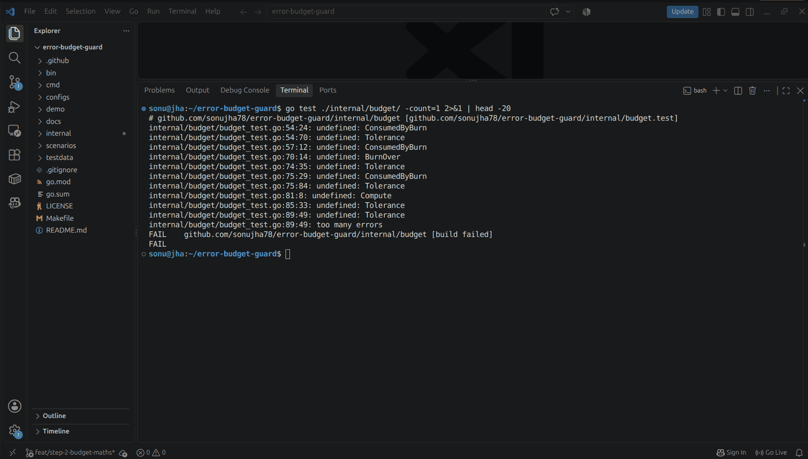
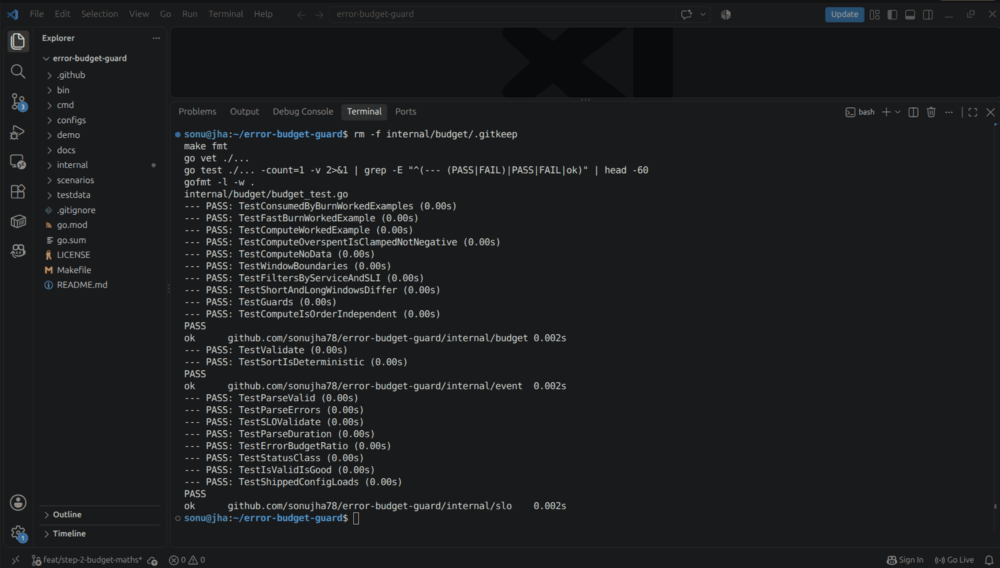

### Step 3: Access-log and probe sources

**What:** parsers for nginx logs (combined format with optional `rt=` and `rid=`), JSON logs and health probe results, path normalisation, redaction at parse time, `ebg parse`. A new rule: **one SLO per (service, sli)**, because events carry no SLO name. First failing test showed the gap, then the fix.
**Why:** the task asks for at least two kinds of source and for secrets to be removed.
**Real-data check:** two real nginx containers (one with `$request_time`, one with the default Docker format). With latency known: `requests=4 events=6`. With the default format (no latency): `events=2 no_latency=2`, because a request that succeeded but has no latency value cannot be judged by a latency SLO, and the tool does not guess. A request carrying `?token=tok_SECRET123` became the label `/|2xx`.

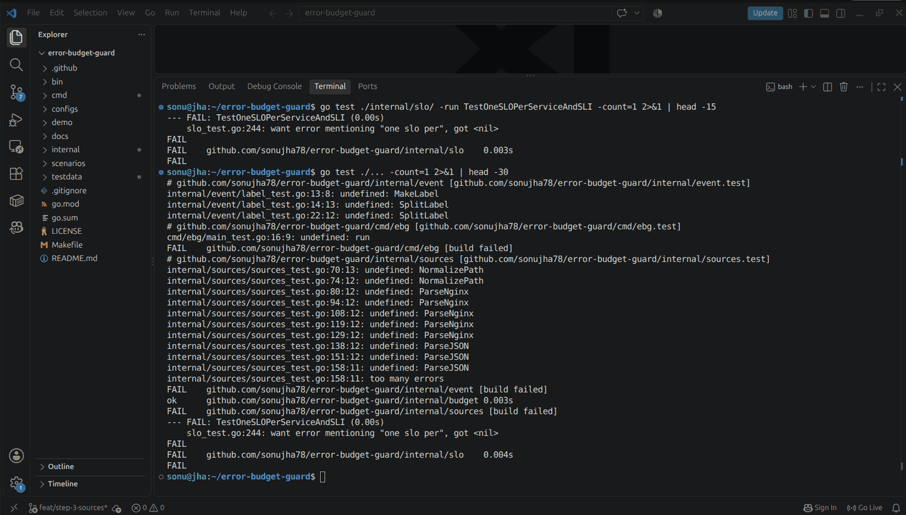
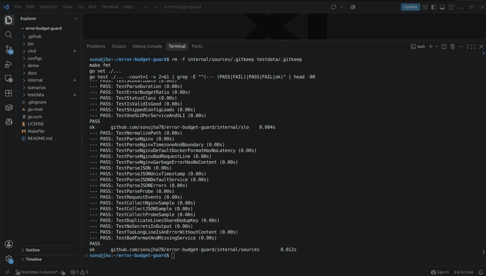
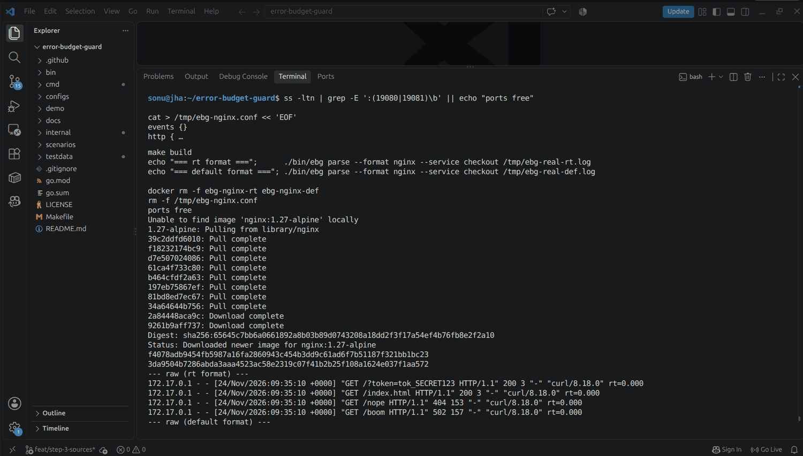
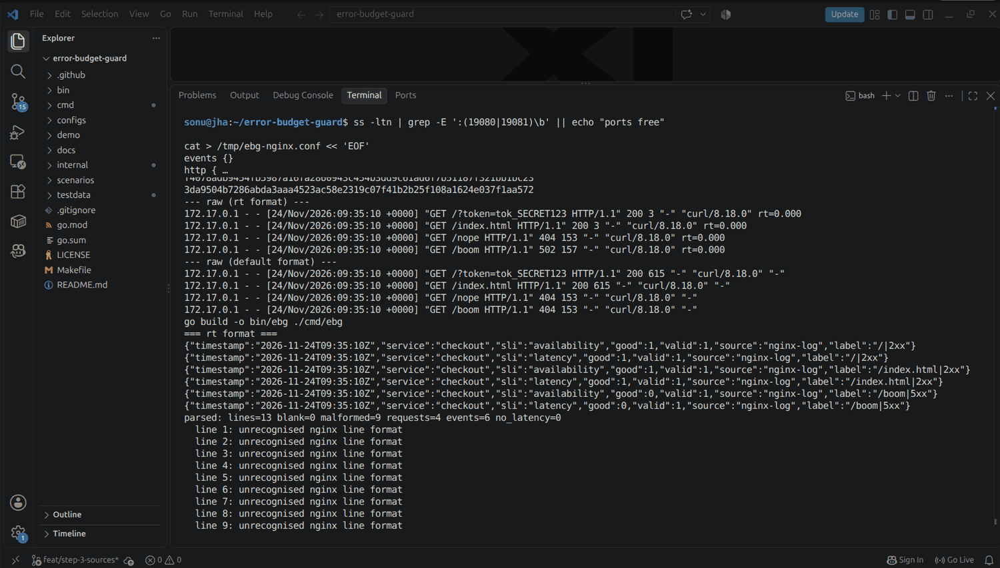

*The raw lines in the screenshot are input (a fake token and the Docker bridge IP), not tool output. The `malformed` count is nginx's own startup banner lines.*

### Step 4: Prometheus scrapes, counter deltas and resets

**What:** a parser for recorded scrape files (each scrape starts with a `# ebg-scrape ts=...` header, because a live `/metrics` response has no timestamp). Counter delta: if `cur >= prev` then `cur - prev`; a drop means a restart, so the delta is `cur` (like Prometheus `increase()`); never negative. The first scrape is only a baseline. A series that disappears for one scrape keeps its last value. A new series counts from zero. Series identity is a hash of all labels (so `instance` IPs or tokens are never stored as text). Latency comes from histogram buckets and **only if the SLO threshold is a bucket boundary**; no interpolation.
**Result (synthetic):** a 3-scrape file with a restart gives 9 resets handled, good 210 and valid 217, matching a hand calculation.
**Real-data check:** a real `prom/prometheus` container. Availability events matched the requests that were sent (`/-/healthy` 5/5, `/-/ready` 3/3, `/api/v1/query` 4/4), the 400 call was excluded, and the token never appeared. Latency produced a clear warning because the real histogram has no `code` label. **It also found a real bug, see below.**

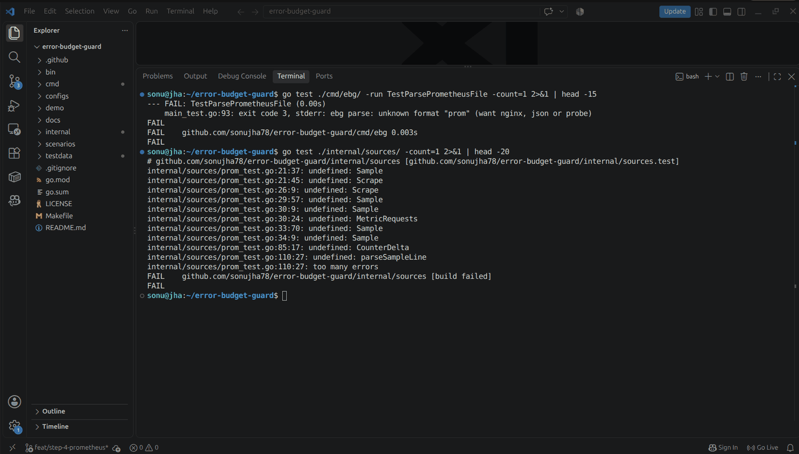
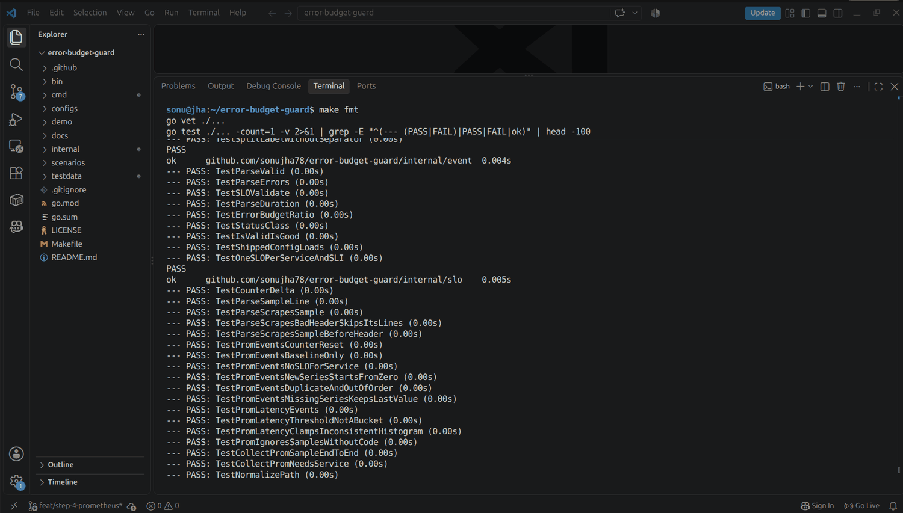
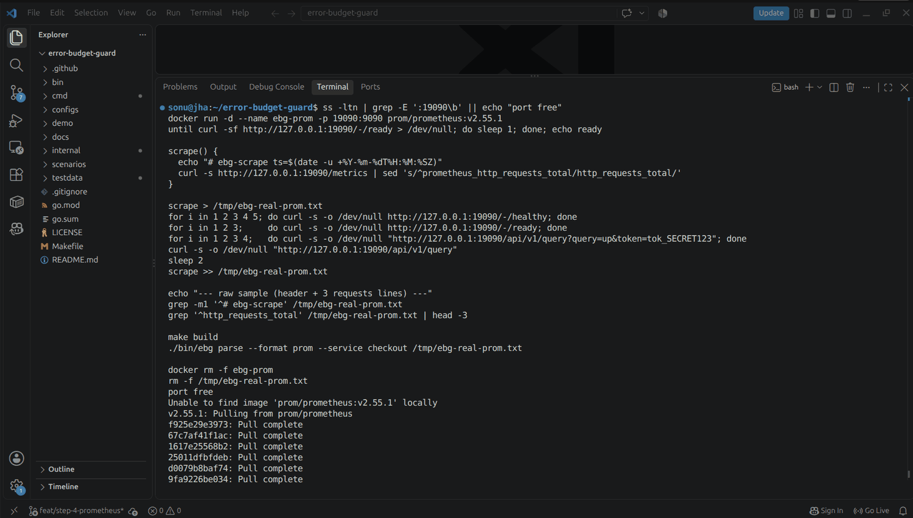
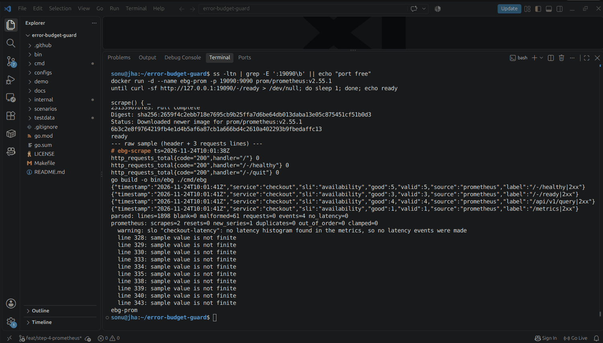

**Fix (separate PR):** `NaN` and `Inf` are valid in the exposition format. Now they are rejected only for the three metrics the guard reads. After the fix, the same real container gives `malformed=0` and the real-data gate passes.

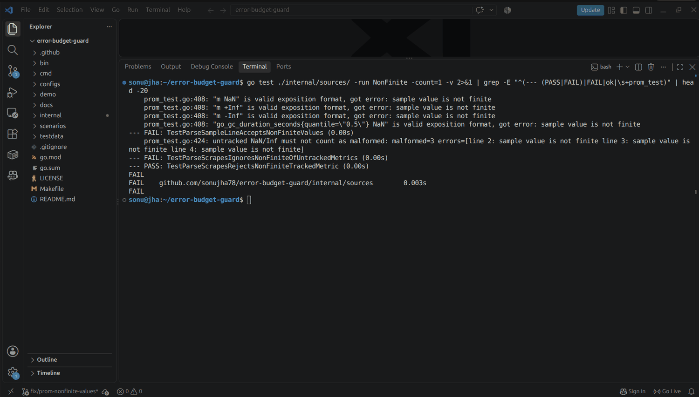
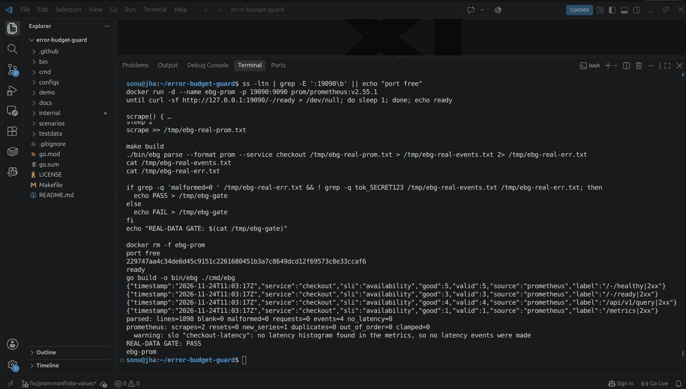

### Step 5: Messy data: duplicates, order, clock skew, gaps

**What:**
- Deduplication on an **explicit request id only** (JSON `request_id`, nginx `rid=`). Line-hash dedupe exists but is **opt-in** (`--dedupe-lines`).
- Out-of-order lines are counted; events are sorted.
- Per-source clock skew: `--skew nginx-log=+3s,probe=-2s` (positive = that clock is ahead). Offsets over 5 minutes are refused as "not clock skew". Names that match no event give a warning.
- Timestamps from the future are clamped (within tolerance) or dropped.
- Gaps and coverage for sources with a known sample interval: a step longer than 1.5x the interval is a gap, and the missing time is the step minus one interval. Access logs only report **silence**, because a quiet period and lost data look the same.
- Accounting: `lines = blank + malformed + requests + duplicates` is a test.

**Why the line-hash dedupe is off by default:** nginx timestamps have one second resolution, so 500 failed retries in one second are 500 identical lines. Deduping them would count one error: false comfort.
**Real-data check (real nginx with `$request_id`):** the same 26 requests were parsed four ways.

| Run | Result |
|---|---|
| A: with request ids | `requests=26 events=50 duplicates=0`, 40 of 50 events bad |
| B: whole log twice | `duplicates=26`, same numbers as A (replay caught exactly) |
| C: ids removed, default | same as A, all 20 identical `/boom` lines counted |
| D: ids removed, `--dedupe-lines` | `requests=3 events=4 duplicates=23`: **20 real failures became 1** |

Run D is the proof why that flag is opt-in.

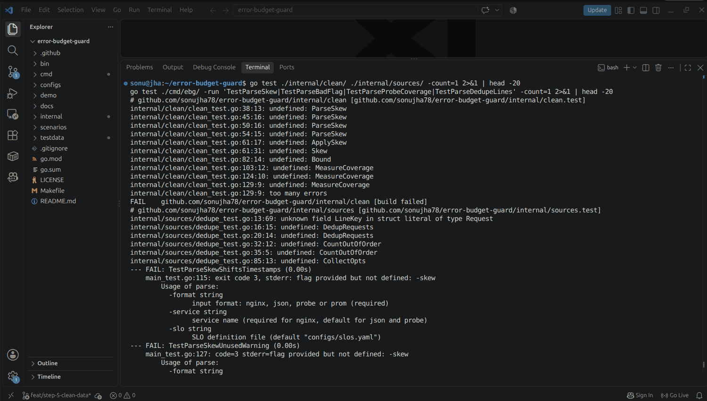
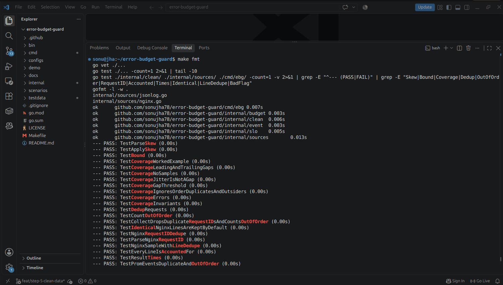
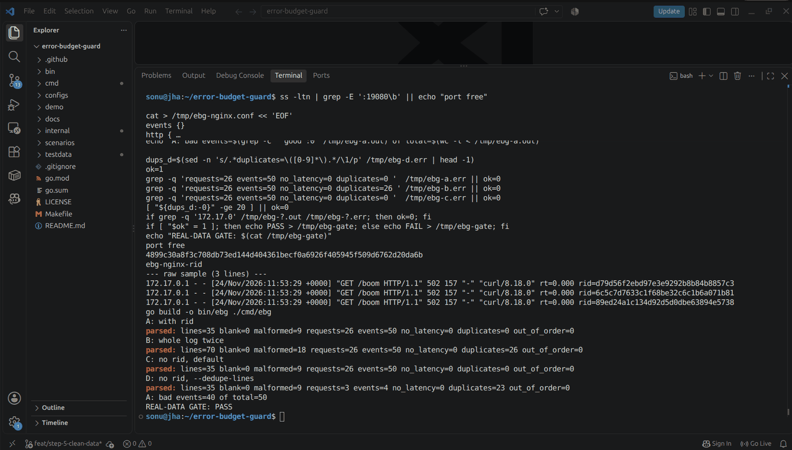

### Step 6: Multi-window, multi-burn-rate alerts

**What:** `internal/alert` and `ebg alerts`. Policy file, proportional window scaling, "both windows" rule, an explanation for every alert (which windows, how much budget), and **episodes** that merge firing moments so an alert that blinks is still one alert. `now` defaults to the newest event, never the wall clock.
**Real-data check:** real nginx traffic with a timed outage (70 s healthy, 20 s outage, 20 s healthy) and ground truth taken from `date`. Fast-burn gave **one episode**, detection delay **1.10 s**, closed **4.63 s** after the outage. Two runs identical.
**What it also showed (and I left in on purpose):** the slow-burn ticket fired on 110 seconds of history and reported "1825.99% of the error budget used". That number is nonsense. It was a known gap handed to the next step.

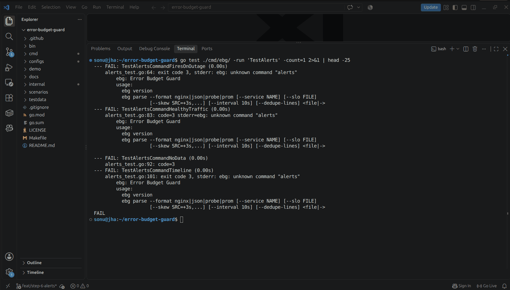
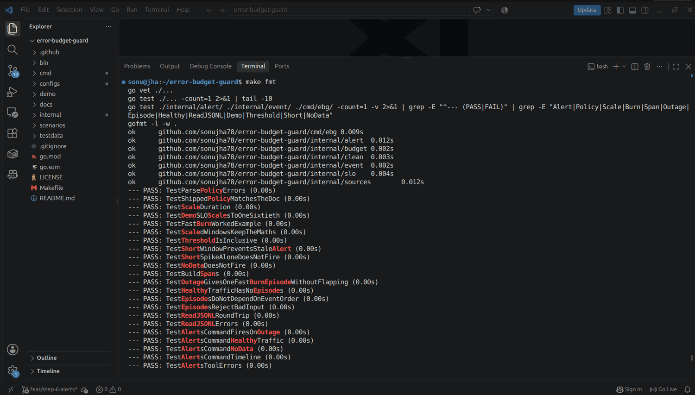
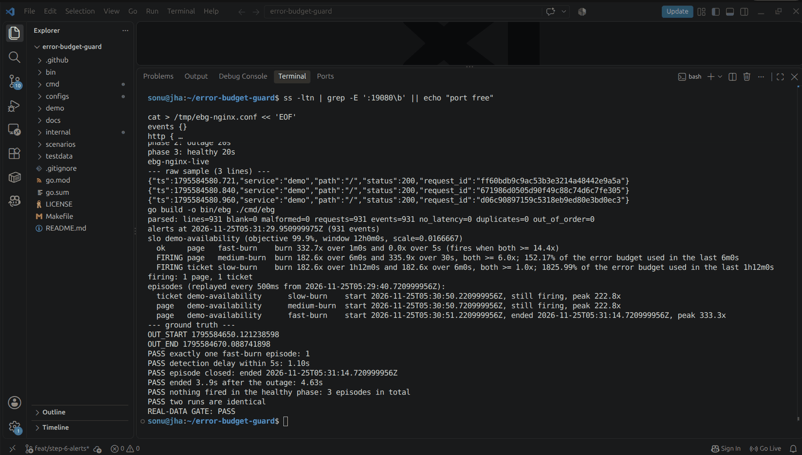

### Step 7: Insufficient data

**What:** each rule checks (a) data exists, (b) history covers at least 80% of **the rule's own scaled long window**, (c) the long window holds enough valid events (default: enough that 5 events would be bad at the threshold burn; for 99.9%: 348, 834 and 5000 events for the three default rules). The budget is also insufficient when the whole budget is smaller than one event. Insufficient rules never fire and show a reason.
**Failing tests first (real assertions):** one failed request among 60 paged at 16.7x; 110 s of history fired the 72-minute rule with "232.73% of the error budget used".
**Real-data check:** the same timed outage as step 6. Fast-burn: one episode, delay **1.33 s**, closed **4.39 s** after. Medium and slow: `insufficient data: history covers 30.4% ... need at least 80%` (and 2.5%). A thinned copy of the same log (every 20th line) said `only 26 valid events in the last 1m0s, need at least 348` and produced no episode.
**Honest note:** the defaults 0.8 and 5 come from design, not from tuning on a dataset.

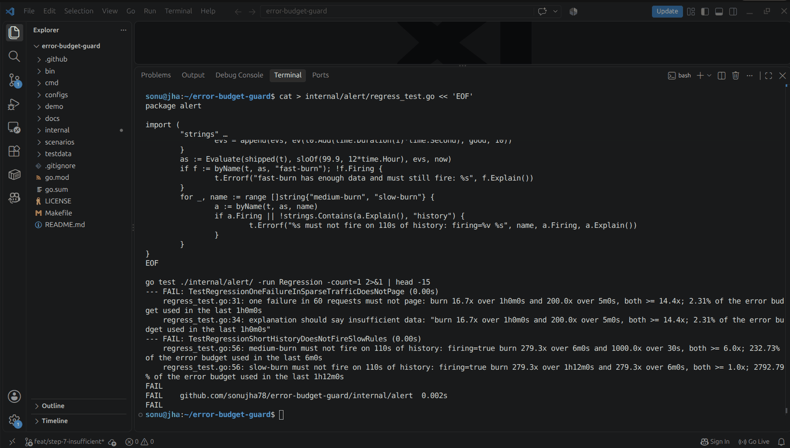
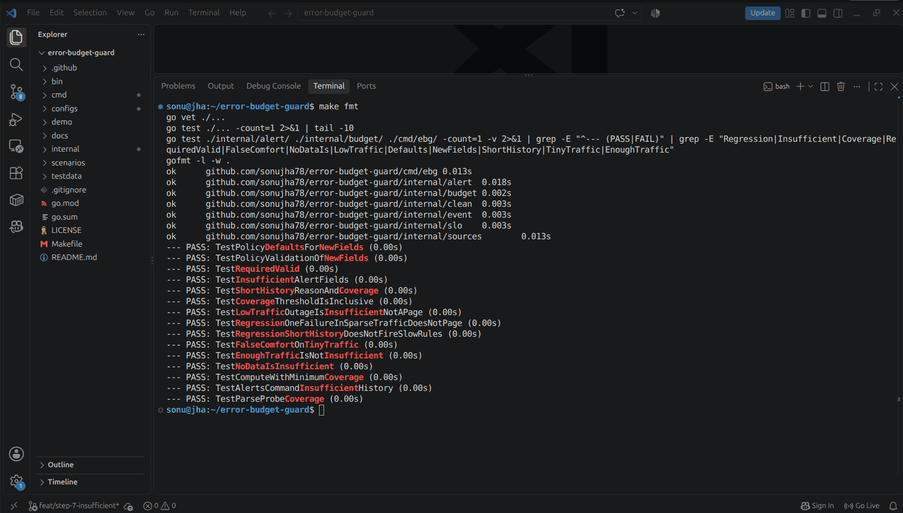
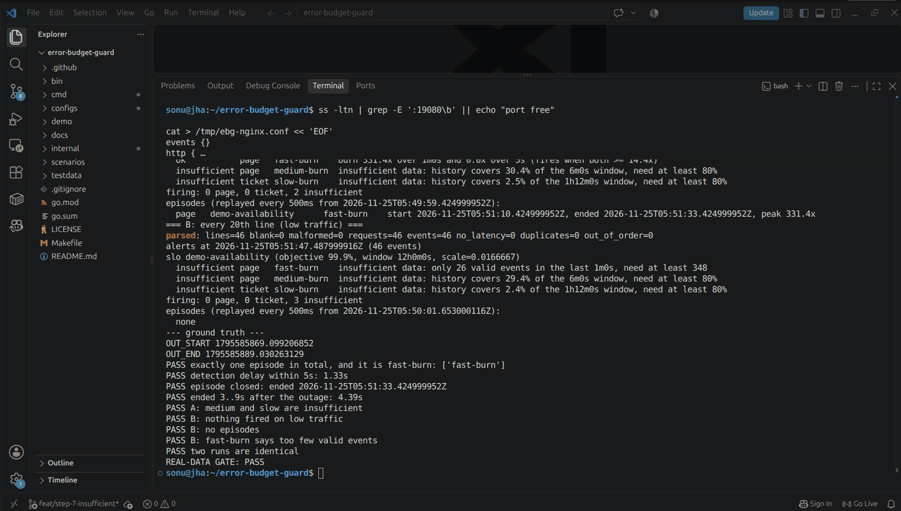

### Step 8: Forecast, error budget policy, gate, override

**What:** `internal/forecast`, `internal/gate`, `ebg gate`. Forecast: `time left = remaining fraction x SLO window / burn`, with burn measured over `SLO window / 12` (configurable). It says "cannot forecast" when the budget is insufficient, the history covers less than 80% of the forecast window, or the window has no valid events. Gate rules and exit codes as described above. Policy errors, a missing field, a bad flag and even `-h` are exit 3.
**Result:** all forecast and gate tests pass (thresholds exactly at 25% and 10%, override rules, worst SLO wins, exit codes).
**Honest note:** the forecast check on real traffic for this step was run, but its output was not saved, so no number from it is claimed here. The forecast accuracy is reported from the step 10/11 scenarios instead (0.0% and 3.5% error).

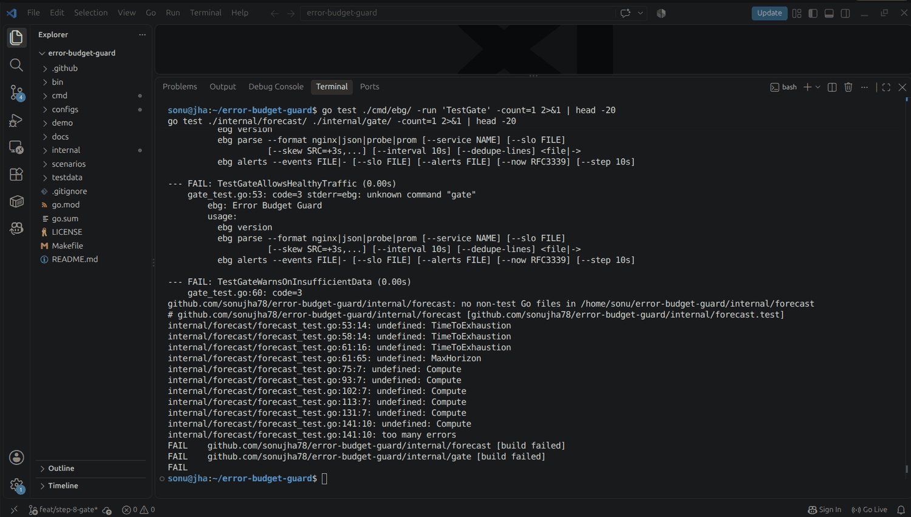
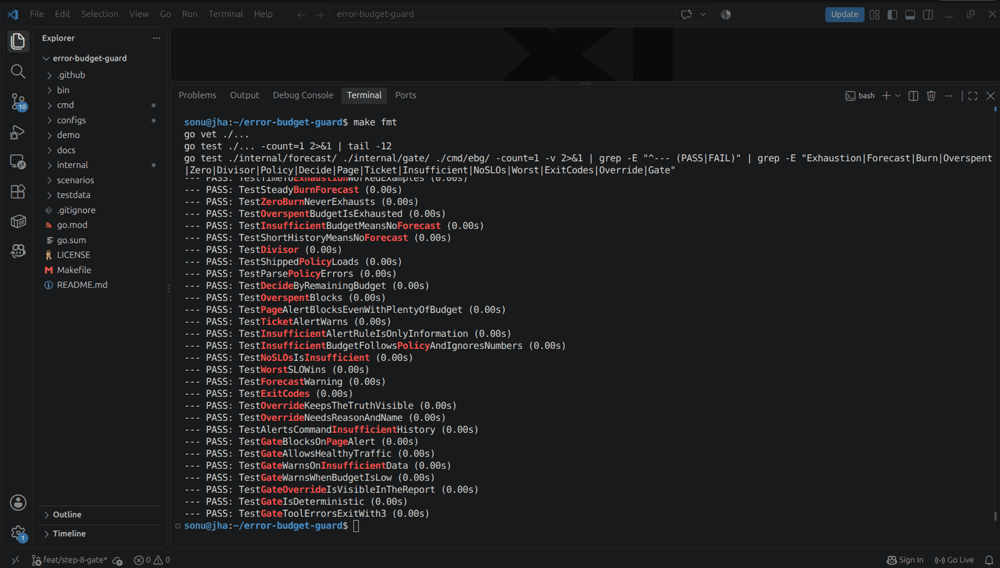

### Step 9: Redaction, Markdown report, replay determinism

**What:** `internal/redact`, `internal/report`, `ebg report`, `ebg parse --stats-out`. The report has the gate decision with reasons, an SLO status table, active alerts (and rules that cannot be judged), top sources of errors by endpoint and status class, the forecast, a data-quality section (how many lines were malformed, duplicates, gaps/silence, warnings) and the override reason if there is one. The override text is scrubbed in both `gate` and `report`.
**Real-data check:** a real nginx log that contains a token, a user id, a cookie id and the client IP in 924 to 1632 lines. None of them appeared in events, stats, report or gate output. The report matched a ground truth computed straight from the raw log: 107 bad of 1632 requests, SLI 93.444%, budget total 16.3 events, only `/boom` as error source, class `5xx` 100%. Two reports were identical.

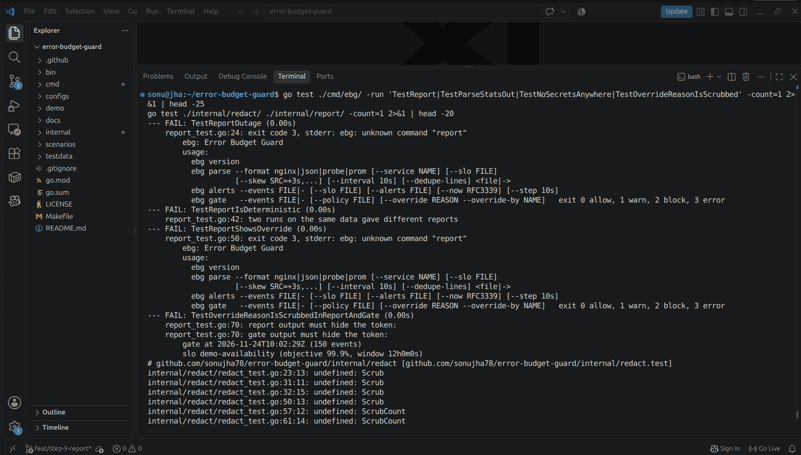
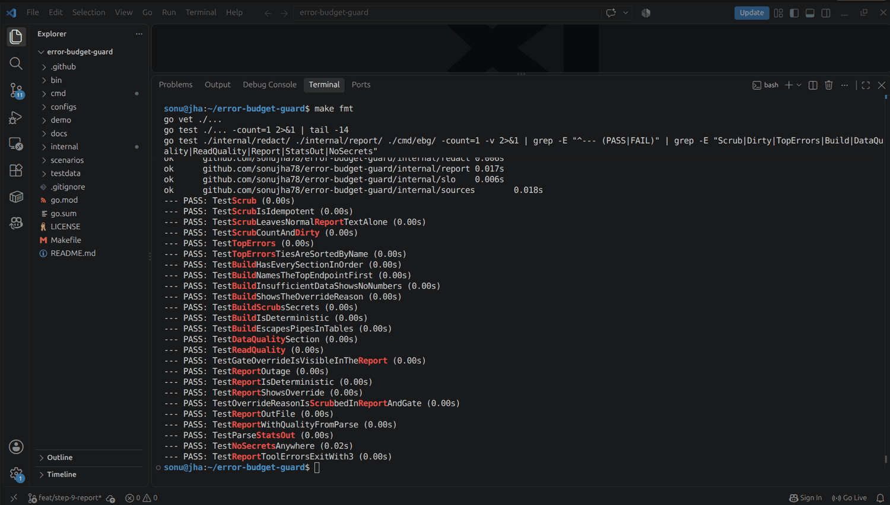

### Step 10: Docker Compose demo, five scenarios, recorded data

**What:** `ebg-app` (Go service with `/metrics`), `ebg-nginx` (JSON access log), `ebg-loadgen` (runs a scenario and writes `truth.json`), `scenario.yaml` files with a deterministic fault plan, `scripts/record-scenario.sh` and `scripts/check-truth.py`. The JSON parser got `latency_s` support (nginx `$request_time` is in seconds). Expected outcomes were written into the scenario descriptions **before recording**.
**Result:** `RECORDING GATE: PASS`. For every scenario, every planned request reached the log, status counts equal what the load generator saw, injected 5xx and slow counts equal the plan, nothing unplanned was slow, and the nginx log and the Prometheus scrapes agree.

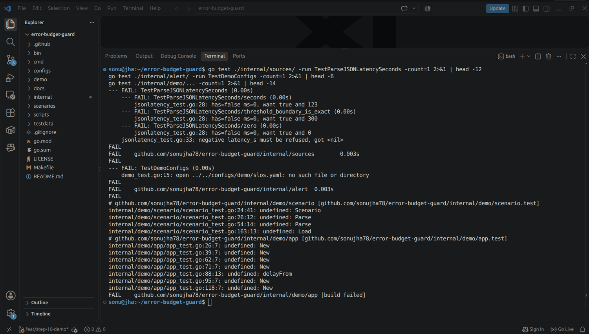
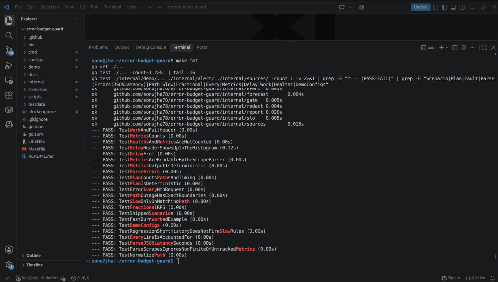

Table of expectations (made before recording) versus what happened:

| Scenario | Expected | Got |
|---|---|---|
| healthy | ALLOW, no alerts | ALLOW (0), none |
| slow-burn | WARN, forecast about 15 s | WARN (1), forecast 15 s |
| fast-burn | BLOCK, page within 5 s, report names `/api/pay` | BLOCK (2), page at 1.5 s and 2.0 s, `/api/pay` 100% |
| latency-degradation | WARN, only the latency SLO | WARN (1), only `demo-latency`, forecast 14.47 s |
| low-traffic | WARN, insufficient, no alert | WARN (1), 3 rules insufficient, SLO table `n/a` |

Two things the table got wrong, kept in the open (see also the next chapter): it forgot that a 5xx is also bad for the latency SLO, and it did not pre-register a delay bound for the slow-burn ticket.

### Step 11: `ebg verify`, GitHub Actions and a deliberate CI failure

**What:** each scenario has `expected.yaml` (gate exit code, which episodes must appear exactly once and within how many seconds of the fault, the top error endpoint, the forecast with a true value and a tolerance, or `insufficient: true`). `ebg verify` runs the full pipeline on the recorded `access.log` and compares. It also fails on **unexpected** alerts and on any alert that appears more than once (flapping). Exit 0 pass, 4 verify failed, 3 tool error.
**A verifier that cannot fail proves nothing.** Seven wrong expectations (wrong gate, too tight a delay, wrong top endpoint, an unexpected alert, a missing alert, "healthy" claimed insufficient, wrong forecast) each have a test that must be caught, and they are.
**CI** (`.github/workflows/ci.yml`, one job named `ci`): `gofmt`, `go vet`, `go test`, build, `ebg verify scenarios/*`, then regenerate all reports and fail if `git status` shows any difference (replay determinism).

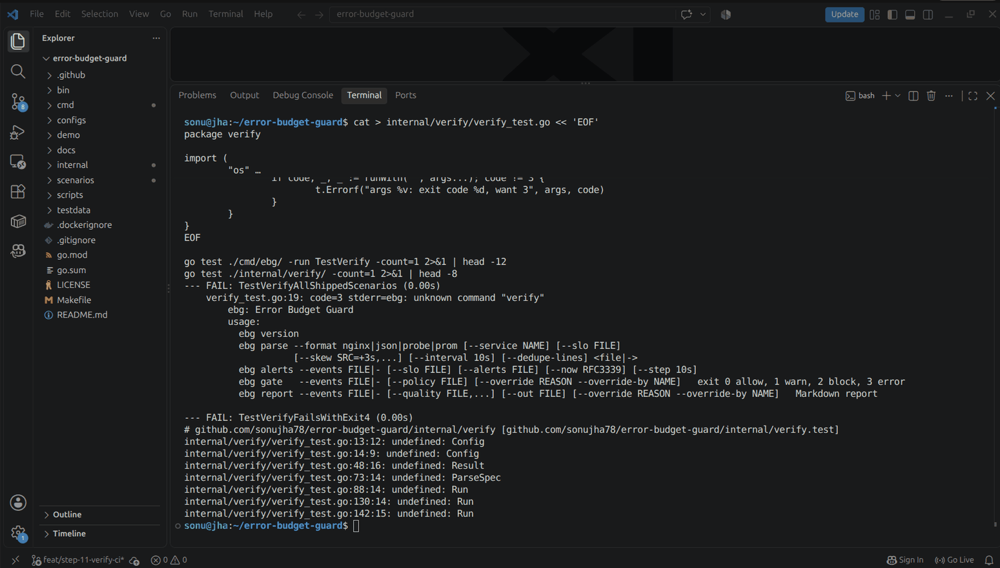


Real data and CI proof:

- `ebg verify scenarios/*`: **5 of 5 scenarios passed**. Alert delays: fast-burn 1.5 s, 2.0 s and 1.5 s; slow-burn 20.0 s; latency 21.0 s. Forecast error: 0.0% and 3.5%.
- Reports regenerated twice: identical for all five. No secret or IP in any report.
- PR #13: the `ci` check **passed** (34 s) and the PR was merged.
- The ruleset was then updated to require the `ci` check.
- **Deliberate failure** (PR #14, never merged): `gate: 2` was changed to `gate: 0` in `scenarios/fast-burn/expected.yaml`. Locally `ebg verify` printed `FAIL gate decision: got BLOCK (exit 2), want exit 0` and exited **4**. On GitHub the `ci` check **failed** (`conclusion: failure`) and `gh pr merge` was refused: `the base branch policy prohibits the merge`. The PR was closed without merging.

---

## Problems found and how they were fixed

These are the real ones, in the order they happened. Several were found only because a real container was used and not only synthetic tests.

| # | Problem | How it was found | Fix |
|---|---|---|---|
| 1 | Two SLOs for the same service and SLI make events ambiguous (events carry no SLO name) | Review while designing step 3; a failing test showed the loader accepted it | Loader now requires one SLO per (service, sli) |
| 2 | **61 lines of real Prometheus output were counted as malformed** because `NaN` is valid in the format | Real `prom/prometheus` container in step 4 (my own prediction said 0) | NaN/Inf are accepted; rejected only for the three tracked metrics. After the fix `malformed=0`. A separate PR |
| 3 | Line-hash dedupe would hide errors: identical lines in one second are real requests | Reasoning in step 5, then proven on real nginx data (20 failures became 1) | Dedupe on explicit request id by default; line dedupe opt-in |
| 4 | Slow-burn ticket fired on 110 s of history and showed "1825.99% of the budget used" | Real outage check in step 6 | Step 7: coverage and minimum-traffic checks, "insufficient data" state |
| 5 | A single failed request in sparse traffic paged (burn 16.7x) | Failing test written first in step 7 | Minimum valid events per rule |
| 6 | My step 6 real-data gate said "nothing fired in the healthy phase" and passed, but that check was only meaningful for fast-burn | Reading the output after the run | Step 7 made the check meaningful for all three rules (exactly one episode, and it is fast-burn) |
| 7 | The pre-registered scenario table said only the availability SLO fires, but a 5xx is also bad for the latency SLO | First look at recorded data in step 10 | `expected.yaml` lists both SLOs; the change is disclosed |
| 8 | The slow-burn alert delay bound was not pre-registered | First look at recorded data in step 10 | Bound of 40 s chosen from the 36 s long window after seeing about 20 s. Disclosed: it was set after looking |
| 9 | The step 8 real-data forecast output was not captured | Reviewing the screenshots before writing this README | No number from it is claimed; the forecast is judged on the recorded scenarios instead |
| 10 | The `rt=$request_timerid=...` seen in one terminal paste | Looked like a log format bug | Only a line-wrap artifact of the terminal copy; the real log had `rt=0.000 rid=...` |
| 11 | Report reasons print `[allow] forecast: the error budget is already used up` | Reading the fast-burn report | Left as a known wart: forecast is only information, the `[block]` line is what decided |

---

## Coverage of the task requirements

The task came as a PDF with 12 requirements and an acceptance list. Honest status:

| Requirement | Status |
|---|---|
| 1. SLOs in YAML (service, SLI type, objective, window, good and valid) | Done. Strict loader |
| 2. At least two kinds of source | Done. nginx/JSON logs, Prometheus text, health probes (the recorded scenarios use logs and Prometheus; probes are covered by parser tests and sample files) |
| 3. One common format | Done (plus the `sli` field) |
| 4. Messy data and "how much was missing" | Done and tested: counter resets, gaps, duplicates, out of order, clock skew. Missing/malformed data is reported when parse statistics are passed to the report |
| 5. SLI, budget (total, used, remaining), burn over several windows | Done |
| 6. Multi-window multi-burn-rate alerts, configurable, scalable, explained | Done |
| 7. Release gate with exit codes, written policy, override with reason shown in the report | Done |
| 8. Forecast at the current burn rate | Done |
| 9. Markdown report with all the listed sections | Done |
| 10. Secrets and personal data removed from everything stored or printed | Done, tested on real logs that contain them |
| 11. Works from collected files **and live**, same result on replay | Files: done, replay identical. **Live: partial**, see limitations |
| 12. Local and CI, no paid cloud | Done |

Constraints and acceptance:

| Item | Status |
|---|---|
| Repeatable traffic with ground truth, at least 4 scenarios plus a low-traffic case | Done: 5 scenarios, deterministic plans |
| Says "insufficient data" when unsure | Done (alerts, budget, forecast, report) |
| Maths checked against worked examples | Done (2%, 5%, 10% examples and more) |
| Tests for SLI, burn, alert logic, gate | Done |
| SLI, budget and burn match hand calculations within a stated tolerance | Done: `1e-9` for ratios |
| Expected alert appears within a stated delay; healthy gives zero alerts; no flapping | Done and verified in CI |
| Gate decision matches for every scenario, reason shown | Done |
| Counter resets and gaps do not make the budget jump or go negative | Done in unit tests (synthetic restart, 9 resets). No real restart was recorded |
| Low-traffic reports insufficient data clearly | Done |
| Forecast within 20% in the steady-burn scenario | Done: 0.0% and 3.5% (see the caveat below) |
| Fast-burn report names the top endpoint | Done: `/api/pay` |
| No token, IP or user id in any output | Done |
| Same data, same report | Done |
| Public repo, Compose demo, recorded data, reports, GitHub Actions, README with diagram and screenshots | Done |
| Stretch goals (Prometheus rules export, Grafana JSON, chat alert, what-if, OpenSLO input, quality score) | **None done** |

---

## Known limitations (honest)

- **Five scenarios, each a single recording.** Every scenario was recorded once on one machine. Numbers like "1.5 s" will differ a little on another machine; that is why CI verifies the committed recordings instead of recording again.
- **"Slow burn" is short.** The slow-burn scenario injects errors at a steady 4% rate, but only during the last 30 seconds of a 3 minute window. The forecast check (error 0.0%) is therefore accurate on a steady rate, but it is not a long, low-level leak over a full window.
- **Thresholds were not tuned on a dataset.** 0.8 coverage, 5 bad events at threshold, 10%/25% gate thresholds, forecast window = SLO window / 12, and the delay bounds of 5 s and 40 s all come from design reasoning. The 40 s slow-burn bound was set after looking at the output.
- **The demo uses its own alert policy.** A 3 minute SLO window and windows in seconds. The Google 2%/5%/10% proportions cannot be reproduced at that scale. The default 30-day policy is shipped and unit tested, but not run on real 30-day traffic.
- **No built-in live mode.** The tool reads files. "Live" in this project means the Compose demo and `record-scenario.sh`, which write the files (access log, scrapes) that `ebg` then reads. There is no long-running collector or daemon.
- **No real counter reset was recorded.** Resets are tested on synthetic scrapes (and on the real Prometheus output, which had none). A reset is detected when a value drops; a restart whose first value is above the previous one would not be seen.
- **Prometheus metric names are fixed:** `http_requests_total` and `http_request_duration_seconds_*`, with `handler`, `code` and `le` labels. Samples without a `code` label are ignored with a warning. The latency threshold must be a histogram bucket boundary; there is no interpolation.
- **Access logs cannot show missing data.** For logs only "silence" is reported. A quiet period and lost data look the same. Probe or scrape sources can report real gaps.
- **Low-traffic services are never paged.** A low-traffic service that is completely down gives "insufficient data", not a page. That is what the task asks for (no false alert), but a real service like that needs a probe source.
- **Redaction is pattern based.** It knows common key names, IPs, JWTs, `tok_`-style tokens and e-mails. It cannot catch an arbitrary unknown secret. IPv6 addresses that start with `::` (like `::1`) are not recognised. The parsers avoid copying such fields in the first place, which is the main protection.
- **The committed raw `access.log` files contain fake secrets and a Docker bridge IP on purpose.** They are test inputs that prove the redaction. All tokens, user ids and cookies in them are made up.
- **Override is trust based.** The gate cannot prove who the person is; it only requires a name and a reason and keeps them visible.
- **No stretch goals.**

---

## CLI and exit codes

| Command | What it does |
|---|---|
| `ebg parse --format nginx\|json\|probe\|prom [--service NAME] [--slo FILE] [--skew SRC=+3s,...] [--interval 10s] [--dedupe-lines] [--stats-out FILE] <file\|->` | Raw data to common events (JSON lines on stdout), statistics on stderr |
| `ebg alerts --events FILE\|- [--slo FILE] [--alerts FILE] [--now RFC3339] [--step 10s]` | Alert state now, and with `--step` the replayed episodes |
| `ebg gate --events FILE\|- [--policy FILE] [--override REASON --override-by NAME] [--forecast-divisor N]` | Release gate |
| `ebg report --events FILE\|- [--quality FILE,...] [--out FILE] [--title T] [--top N] [...gate flags]` | Markdown report |
| `ebg verify DIR...` | Check recorded scenarios against `expected.yaml` |
| `ebg version` | Version |

| Exit code | Meaning |
|---|---|
| 0 | `gate`: allow. Others: success |
| 1 | `gate`: warn |
| 2 | `gate`: block |
| 3 | Tool error (bad flag, bad config, unreadable input, even `-h` on `gate`) |
| 4 | `verify`: a scenario did not match its expectation |

Configuration files: `configs/slos.yaml` (example SLOs), `configs/alerts.yaml` (30-day alert policy), `configs/policy.yaml` (error budget policy), `configs/demo/` (the demo's SLOs and its seconds-scale alert policy).

---

## Repository layout

```
cmd/ebg/               the CLI (parse, alerts, gate, report, verify)
cmd/ebg-demoapp/       demo web service (with /metrics)
cmd/ebg-loadgen/       deterministic load generator, writes truth.json
internal/event/        common event, JSON-lines reader, label helpers
internal/slo/          SLO YAML loader, good/valid rules
internal/sources/      nginx, JSON, probe and Prometheus parsers, dedupe
internal/clean/        clock skew, future bounds, gap coverage
internal/budget/       SLI, budget, burn rate, history coverage
internal/alert/        multi-window alerts, scaling, episodes
internal/forecast/     time to exhaustion
internal/gate/         error budget policy, decision, override
internal/redact/       scrubbing of secrets and personal data
internal/report/       Markdown report, data-quality section
internal/verify/       expected.yaml checks
internal/demo/         scenario plans and the demo app
configs/               SLO, alert and gate policies (plus configs/demo/)
scenarios/NAME/        scenario.yaml, expected.yaml, access.log, metrics.txt, truth.json, report.md
demo/                  Dockerfile, nginx.conf, docker-compose.yml
scripts/               record-scenario.sh, check-truth.py, make-reports.sh
.github/workflows/     ci.yml
docs/images/           screenshots used in this README
```

---

## Interview talking points

- **"Why not alert on one error-rate threshold?"** A single threshold is either too sensitive (pages on blips) or too slow. Pairing a long and a short window gives fast detection and fast recovery, and several burn rates cover both outages and slow leaks.
- **"How do you shrink the windows for a demo without breaking the maths?"** Scale all windows by the same factor and keep the burn thresholds. The budget consumed by "burn x long window / SLO window" does not change. I tested that, and I also explain why the demo still needed its own policy.
- **"Tell me about a bug you found."** Real Prometheus output showed 61 false malformed lines because `NaN` is valid. Synthetic tests had not found it. Another: the first alert version said 1825% of the budget was used on 110 seconds of data, which led to the insufficient-data design.
- **"Why is line-based deduplication off by default?"** Because it silently turned 20 real failures into 1 on real nginx data. False comfort is worse than a duplicate.
- **"How do you avoid blocking emergency fixes and stay trustworthy?"** The override needs a name and a reason, makes the exit code 0, and the original decision, reasons and the override reason stay in the output and the report. The override text itself is scrubbed for secrets.
- **"How do you test a tool like this?"** Ground truth comes from a deterministic load plan, the expected outcome is written before recording, two independent sources are cross-checked, the verifier is itself tested to fail on wrong expectations, and CI was deliberately broken to prove it fails and blocks the merge.
- **"What would you do next?"** Export Prometheus recording and alert rules from the SLO file, a live collector, a what-if command, and recording a real long low-level leak and a real restart.

---

## Tech used

Go 1.22, `gopkg.in/yaml.v3`, Docker and Docker Compose, nginx, Prometheus text format, GitHub Actions, GitHub rulesets (`gh` CLI), Mermaid, shell and a little Python for check scripts. No paid cloud service.

## License

MIT
